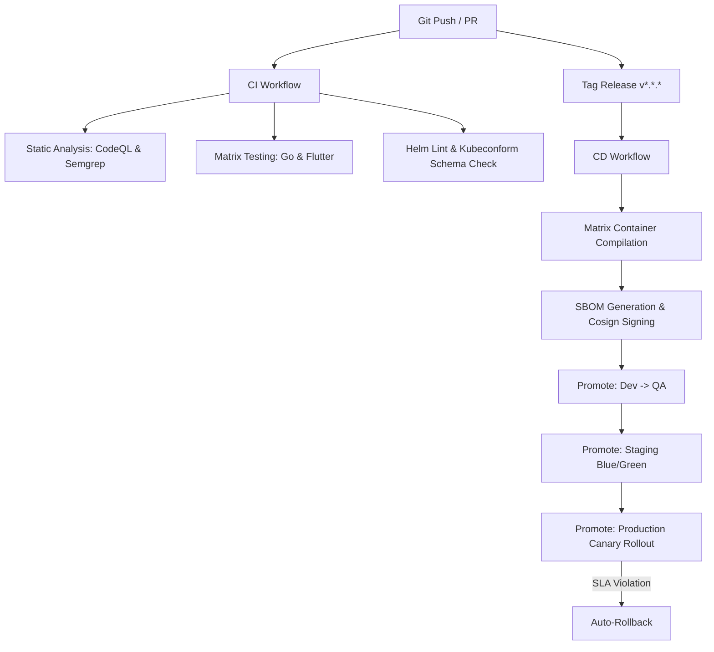

# Staff-Engineer Operations Guide
## Enterprise CI/CD, DevSecOps, and Production Readiness Playbook

---

## 1. CI/CD Pipeline Architecture



### 1.1. CI Workflow Stages
1.  **Static Analysis**: Integrated GitHub CodeQL and Semgrep scanning Go codebases. Outputs SARIF templates uploaded directly to PR annotations.
2.  **Matrix Verification**: Tests Go against multiple compiler versions (`1.21`, `1.22`) and Flutter across multiple release channels (`stable`, `beta`) in parallel execution.
3.  **Helm & Schema Checks**: Evaluates manifests using `helm lint`, dry-run generation, and `kubeconform` to validate Kubernetes API specifications.

### 1.2. CD Promotion Workflow
*   **Build Once**: Docker compiles multi-stage images once, generating CycloneDX and SPDX SBOM files.
*   **Sign and Attest**: Cosign signatures are generated using OCI image digests. SBOM assets are attested directly to the image registry.
*   **Promote by Digest**: Environments pull specific image digests (`auth@sha256:...`) avoiding mutable tag issues.

---

## 2. Release & Environment Promotion Strategy

We utilize 4 isolated environments with progressive promotion criteria:

```
[ Developer Branch ] ──► [ Dev Environment ] ──► [ QA Environment ] ──► [ Staging (Blue/Green) ] ──► [ Production (Canary) ]
```

### 2.1. Promotion Gates
1.  **Dev**: Automatic deploy on commit pushes to `main`. Used for continuous developer testing.
2.  **QA**: Automated promotion after Dev unit verification passes. Used for feature QA testing.
3.  **Staging**: Requires a completed QA verification and manual approval gate. Deployed using parallel Blue/Green templates.
4.  **Production**: Requires successful staging smoke tests and SRE approval. Progressively rolls out using Canary Ingress weights (10% -> 100%).

---

## 3. Secret Management (External Secrets Operator)
Production workloads pull secrets from GCP Secret Manager via the **External Secrets Operator (ESO)**:

*   **ClusterSecretStore**: Connects to the GCP SM API using a cluster-wide service account.
*   **ExternalSecret**: Requests specific keys (e.g. `db_prod_password`, `aws_prod_access_key_id`) and maps them to a local Kubernetes `Secret` (`easychat-secrets`).
*   **Decoupled Workloads**: Microservices only read standard K8s secrets; they never talk directly to GCP SM, ensuring local development compatibility.

---

## 4. Disaster Recovery (DR) Plan

### 4.1. Backup Schedules
*   **Postgres**: Continuous archiving of WAL logs to S3 using pgBackRest. Full backups executed every 24 hours.
*   **Redis**: Snapshot RDB files captured every 4 hours and stored in offsite locations.

### 4.2. Recovery RTO/RPO Targets
*   **Recovery Time Objective (RTO)**: < 1 hour (Fully restoring service in a backup region).
*   **Recovery Point Objective (RPO)**: < 5 minutes (Maximum allowed data loss window).

### 4.3. Failover Execution
1.  Redirect global DNS traffic to the hot-standby region using Cloudflare DNS.
2.  Restore the latest Postgres backup in the standby cluster.
3.  Deploy Helm charts using the latest verified release tag.
4.  Execute verification smoke tests on the standby Ingress endpoint.

---

## 5. DORA Production Metrics Dashboard

SRE dashboards track the four core DORA metrics to measure delivery performance:

1.  **Deployment Frequency**: Number of successful production deployments per week.
2.  **Lead Time for Changes**: Duration from code commit to production release.
3.  **Change Failure Rate**: Percentage of deployments triggering rollbacks or incidents.
4.  **Mean Time to Restore (MTTR)**: Average duration to resolve production incidents (SLA target < 15 minutes).
