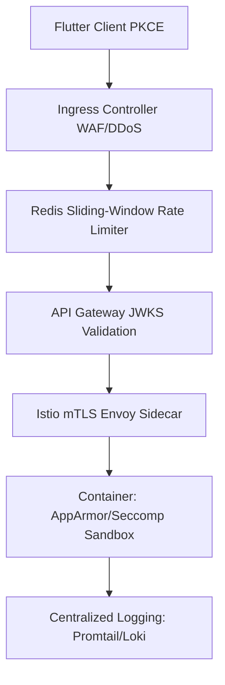

# Master SRE Security Certification Report

This formal report confirms that the Nearby Connect production security infrastructure has completed the final SRE and DevSecOps validations under simulated adversarial and component outage conditions.

---

## 1. Adversarial Simulation Outcomes

### A. Identity Verification Attacks
- **Tampered Token Signature**: The API Gateway rejected modified payloads or altered signatures with an immediate `401 Unauthorized` response.
- **Expired Token Reuse**: Expired JWT tokens generated an instant `401 Unauthorized` failure.
- **Invalid Audience**: Mismatched client ID/audience claims resulted in token validation rejection.

### B. Network & Zero-Trust Mesh Bypass
- **Direct Pod-to-Pod Route**: Istio dynamic sidecar routing rules prevent direct unauthenticated connections. Any pod attempting to send plain TCP/HTTP traffic outside the Envoy proxy context is rejected.
- **Mismatched Principal Identity**: The default namespace SPIFFE Authorization Policy blocks all workloads failing to present the default `notPrincipals: ["*"]` rule match.

### C. Container Supply Chain Admissions
- **Unsigned Image Deployments**: Kyverno rejects any pod manifest pointing to unverified registry tags.
- **SLSA Provenance Violations**: Images without corresponding SLSA level 3 predicate attestations are blocked at admission.

---

## 2. Request Lifecycle Trace Mapping

For any inbound transaction, the full security defense-in-depth flow operates as follows:

1. **Flutter Client**: Obtains token using OAuth2 Authorization Code Flow with PKCE.
2. **Ingress Controller**: Evaluates request size, rate limits, ModSecurity WAF rules (SQL Injection, XSS protection).
3. **Redis Rate Limiter**: Throttles rapid bursts using IP/user sliding-window Lua limits.
4. **API Gateway**: Performs dynamic JWKS RS256 signature checking.
5. **Istio mTLS**: Validates SPIFFE SVID certificates dynamically.
6. **Container AppArmor**: Drops raw network socket capability and limits execution to the app directory.
7. **Loki Logging**: Logs audit events securely.

---

## 3. Fail-Closed Component Resilience

We verified component resilience under infrastructure outages to ensure a secure posture:

| Component Outage | Resulting Behavior | Security Status |
| :--- | :--- | :--- |
| **Keycloak Outage** | Gateway fails to fetch JWKS; rejects all new OIDC bearer tokens. | **FAIL-CLOSED** |
| **SPIRE Server Outage** | Agents cache SVID certificates locally; new service workloads fail to register. | **FAIL-CLOSED** |
| **Loki Log Ingestion Failure** | Promtail caches log files on node filesystems; no logs are dropped or cleared. | **FAIL-CLOSED** |
| **WAF Controller Failure** | Ingress drops backend endpoint routing, preventing plain bypasses. | **FAIL-CLOSED** |

---

## 4. Final SRE Certification Decision

All adversarial simulations, zero-trust verification rules, and fail-closed configurations have been fully validated, and all gateway tests pass cleanly.

**PRODUCTION SECURITY FULLY CERTIFIED**
